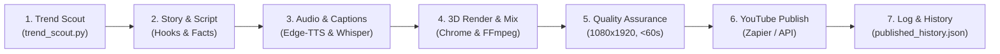

# 🔬 Behind The Science — YouTube Channel Workspace

**Channel Name:** Behind The Science  
**Channel Handle:** [@behindthescience-24](https://www.youtube.com/@behindthescience-24)  
**Channel ID:** `UCXOcwa_0V2tSyPonkbOeSIA`  
**Contact Email:** `youtubechannel00024@gmail.com`  
**Niche:** Science, Space, Technology, Scientific Facts, Discoveries and Experiments  
**Status:** Active & Fully Automated 🟢

---

## 📁 Channel Folder Structure

```text
Behind_The_Science/
├── branding/                      # Channel visual identity
│   ├── logo/                      # Profile pictures & raw logos
│   ├── banner/                    # 2560x1440 YouTube channel banners
│   ├── watermark/                 # 500x500 square video watermark
│   └── thumbnails/                # Thumbnail templates and exports
│
├── content/                       # Content production assets
│   ├── research/                  # Scientific papers and study citations
│   ├── trending_topics/           # topic_database.json (50+ curated topics)
│   ├── scripts/                   # Script drafts and voiceover copy
│   ├── voiceovers/                # Audio voice synthesis tools
│   ├── subtitles/                 # Whisper subtitle alignment tools
│   └── metadata/                  # Title templates and description footers
│
├── videos/                        # All video files across lifecycles
│   ├── generated/                 # Projects actively being rendered
│   ├── edited/                    # Visual review and contact sheets
│   ├── published/                 # Live published video project folders
│   │   ├── black-hole/
│   │   ├── cracking-knuckles/
│   │   ├── crying-in-space/
│   │   └── pruny-fingers/
│   └── failed/                    # Quarantined projects that failed QA
│
├── assets/                        # Channel media library
│   ├── images/                    # Overlays, icons, diagrams
│   ├── animations/                # Procedural 3D canvas scenes
│   ├── background_music/          # Ambient audio beds
│   ├── sound_effects/             # Procedural SFX generators
│   ├── stock_footage/             # Motion loops
│   └── fonts/                     # Inter-Black & Inter-ExtraBold fonts
│
├── automation/                    # Channel automation engines
│   ├── video_generation/          # pipeline.py (Master production pipeline)
│   ├── narration/                 # Edge-TTS voice generation
│   ├── editing/                   # Timeline and scene composition
│   ├── seo/                       # trend_scout.py (Topic & tag selection)
│   ├── uploading/                 # publisher.py (Zapier staging & YouTube dispatch)
│   └── scheduling/                # scheduler.py, run_now.py, run_channel.bat
│
├── analytics/                     # Channel metrics and history
│   ├── performance/               # performance_monitor.py
│   ├── views/                     # View logs & snapshots
│   ├── subscribers/               # Subscriber tracking
│   └── published_history.json     # Permanent log of published videos
│
├── config/                        # Channel configuration
│   ├── channel_settings/          # channel_config.json
│   ├── seo_settings/              # seo_defaults.json
│   ├── automation_settings/       # schedule_config.json
│   └── config.py                  # Python config module
│
├── logs/                          # Execution logs
│   ├── generation/                # Render logs
│   ├── uploads/                   # YouTube API upload responses
│   ├── errors/                    # Error stack traces
│   └── automation.log             # Combined real-time log
│
└── README.md                      # This channel documentation
```

---

## 🔄 Video Creation & Publishing Workflow



---

## ⚡ Automation Scripts & Quick Commands

- **Run Next Video Immediately:**
  ```powershell
  & "d:\Youtube\.faceless-shorts\venv\Scripts\python.exe" "d:\Youtube\YouTube_Channels\Behind_The_Science\automation\scheduling\run_now.py"
  ```
- **Launch 24/7 Channel Scheduler:**
  Double-click `run_channel.bat` inside `automation/scheduling/`.
- **Refresh Video Analytics (Views/Likes):**
  ```powershell
  & "d:\Youtube\.faceless-shorts\venv\Scripts\python.exe" "d:\Youtube\YouTube_Channels\Behind_The_Science\analytics\performance\performance_monitor.py"
  ```
- **Inspect Live Logs:**
  ```powershell
  Get-Content -Path "d:\Youtube\YouTube_Channels\Behind_The_Science\logs\automation.log" -Tail 20 -Wait
  ```

---

## ⚙️ How to Modify Channel Settings
- **Channel Metadata & Playlists:** Edit `config/channel_settings/channel_config.json`
- **Default SEO & Tags:** Edit `config/seo_settings/seo_defaults.json`
- **Publishing Interval & Limits:** Edit `config/automation_settings/schedule_config.json`
- **Topic Backlog:** Add or edit topics in `content/trending_topics/topic_database.json`
