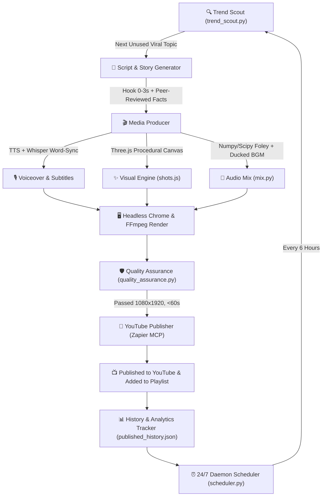

# 🔬 Behind The Science — Fully Autonomous YouTube Automation Agent

[](https://www.youtube.com/@behindthescience-24)
[](https://www.youtube.com/channel/UCXOcwa_0V2tSyPonkbOeSIA)
[](#strict-youtube-monetization-compliance)

**Autonomous AI agent that autonomously researches trending science topics, writes engaging high-retention scripts, synthesizes 3D/2D visual scenes, generates procedural audio/SFX, performs strict QA verification, and publishes YouTube Shorts 24/7.**

---

## 🚀 Published Videos Live On Channel

1. [What REALLY Happens When You Crack Your Knuckles? 💥🦴](https://www.youtube.com/watch?v=MaDtHo_ug4Y) (22.3s)
2. [Why Do Your Fingers ACTUALLY Wrinkle in Water? 🛁🖐️](https://www.youtube.com/watch?v=I5lO2_n_bSI) (22.3s)
3. [What REALLY Happens If You Fall Into a Black Hole? 🕳️⏳](https://www.youtube.com/watch?v=7PS6A-MckpU) (59.96s)
4. [Can You ACTUALLY Cry in Space? 🚀😭](https://www.youtube.com/watch?v=v5rzutkL1_s) (24.4s)

---

## 🛠️ System Architecture



---

## 📁 Repository Structure

```
├── config.py                 # Channel IDs, Category 28, Playlists, Timing guardrails
├── trend_scout.py            # Deduplication and priority-based topic selector
├── topic_database.json       # Curated database of 50+ viral science topics
├── published_history.json    # Live tracker of published video IDs, URLs & statistics
├── quality_assurance.py      # Automated pre-upload validation (duration, resolution, audio)
├── publisher.py              # Staging and YouTube upload dispatcher
├── performance_monitor.py    # Analytics tracker fetching views, likes, and comments
├── pipeline.py               # Master end-to-end production orchestrator
├── scheduler.py              # Continuous 24/7 daemon runner
├── run_now.py                # Instant manual trigger
└── run_autonomous_agent.bat  # Standalone Windows launcher
```

---

## ⚡ Quick Start & Commands

### 1. View Live Automation Logs
```powershell
Get-Content -Path "d:\Youtube\autonomous_agent\automation.log" -Tail 20 -Wait
```

### 2. Trigger an Immediate Video (Manual Override)
```powershell
& "d:\Youtube\.faceless-shorts\venv\Scripts\python.exe" "d:\Youtube\autonomous_agent\run_now.py"
```

### 3. Run Daemon Service
```powershell
.\run_autonomous_agent.bat
```

---

## 🛡️ Monetization & Safety Guardrails
- **Publishing Rhythm:** Calibrated to **every 6 hours (4 videos/day)** across global peak viewing hours. Prevents YouTube algorithmic spam flags and protects YouTube Partner Program (YPP) monetization eligibility.
- **Original Content:** All scripts use peer-reviewed citations, procedural sound design (zero copyright strikes), and custom vector/canvas animations.
